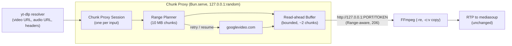

# Implementation Plan: Chunked Input Proxy for YouTube Streams

This plan describes a small local HTTP proxy inside the plugin that fetches YouTube media the way yt-dlp's own downloader does (many short range requests, with read-ahead and retries) and serves it to FFmpeg over `127.0.0.1`. It replaces the single long-lived googlevideo connection that currently drops mid-track, and it replaces the experimental `async:` wrapper.

---

## 1. Problem & Evidence

| Observation (from server logs) | Cause |
| :--- | :--- |
| `Connection reset by peer` / `Will reconnect ... Input/output error` on googlevideo URLs | FFmpeg holds one long open-ended HTTP connection per input; googlevideo appears to throttle and reset those |
| Video stutters when the CDN stalls even briefly | `-re -readrate_initial_burst 0` means there is zero read-ahead; any stall reaches viewers |
| Track ends early (`Music ended`) with `async:` input buffer | The async wrapper surfaces a TLS/EIO error before the HTTP reconnect completes |

`-readrate_initial_burst` is **not** a fix: reading ahead also sends ahead, so it would push seconds of RTP to mediasoup in one burst.

**Reference behaviour**
- yt-dlp's downloader requests YouTube media in ~10 MB ranges (`http_chunk_size`) instead of one long request.
- mpv's `ytdl_hook` hands URLs to FFmpeg but keeps a large demuxer cache (tens of seconds / ~150 MiB) and can pause to rebuffer. A live restream cannot pause, so it needs the cache and the chunking.

---

## 2. High-Level Architecture



Everything after FFmpeg is unchanged. Only where FFmpeg reads its input from changes.

---

## 3. Key Components & Required Changes

### Phase 1: Chunk Proxy Server (`src/server/chunk-proxy.ts`, new)

#### Goals
- One lazily started `Bun.serve` bound to `127.0.0.1` on a random port.
- Sessions keyed by an unguessable random token (`/<token>`), created per input and closed on cleanup.

#### Implementation Details
1. **Session type**
   ```ts
   type TProxySession = {
     token: string;
     upstreamUrl: string;
     headers: Record<string, string>;   // from yt-dlp http_headers
     proxy?: string;                    // plugin Proxy URL setting
     totalBytes: number | null;         // learned from the first ranged response
     mimeType: string | null;
     abort: AbortController;
     stats: { bytes: number; retries: number; chunks: number };
   };
   ```
2. **Public API**
   ```ts
   createProxySession(options): Promise<{ url: string; close: () => void }>;
   stopChunkProxy(): void; // onUnload
   ```
3. **Learning the size**: before handing the URL to FFmpeg, request `bytes=0-0` (or the first chunk), read `Content-Range: bytes 0-0/TOTAL`, and store `totalBytes` and `Content-Type`.
4. **Serving FFmpeg**
   - Reply `206` with `Content-Range`, `Content-Length` and `Accept-Ranges: bytes` for ranged requests; `200` with full length otherwise.
   - Support any start offset (FFmpeg may seek when probing or reconnecting): drop the buffer and restart the chunk window at that offset.
   - Support `HEAD`.
   - Reject any request whose path token is unknown with `404`.
5. **Bound**: the response body is a pull-based `ReadableStream`, so the proxy only reads ahead while its buffer has room. FFmpeg is paced by `-re`, which is what provides the back-pressure.

---

### Phase 2: Range Planner, Read-Ahead & Retry

#### Goals
- Fetch in fixed-size chunks, stay a bounded distance ahead of the reader, and survive failed chunks without FFmpeg ever noticing.

#### Implementation Details
1. **Constants** (not user settings)
   ```ts
   const CHUNK_BYTES = 10 * 1024 * 1024;      // matches yt-dlp
   const FIRST_CHUNK_BYTES = 1 * 1024 * 1024;  // small first chunk so playback starts fast
const READ_AHEAD_CHUNKS = 1;               // chunk being served + 1 ahead = ~20 MB per input
   const CHUNK_TIMEOUT_MS = 15_000;           // no bytes for this long = failed attempt
   const CHUNK_MAX_ATTEMPTS = 4;
   ```
   At 720p (~2.5 Mbps) one chunk is ~30 s of video, so the buffer holds around a minute; audio chunks last longer still.
2. **Range request form**: use a standard `Range: bytes=START-END` header. If upstream answers `200` to a ranged request past byte 0 (header ignored), switch the session to YouTube's `&range=START-END` query parameter. *(Changed from the original draft, which led with the parameter: the header is the standard form and the parameter is the fallback.)*
3. **Retry rule**: on timeout, reset or 5xx, wait with backoff (250 ms, 500 ms, 1 s, 2 s) and **resume from the last byte received**, not from the chunk start.
4. **Expired URL (403/410)**: googlevideo URLs expire. A typed `UpstreamExpiredError` triggers the session's `refreshUrl` callback (max 2 refreshes). The refreshed URL is only used if its `clen` (content length) matches the old one, since a different size means a different format.
5. **Proxy and headers**: pass `proxy` to Bun's `fetch` and send yt-dlp's `http_headers` on every request, not only `User-Agent`.

---

### Phase 3: FFmpeg Integration (`src/server/ffmpeg.ts`)

#### Goals
- Point FFmpeg at the local URLs when the setting is on, without changing anything downstream.

#### Implementation Details
1. For YouTube inputs, create one proxy session per URL (video and audio; one session if the URL is shared).
2. Input args for a proxied input:
   ```bash
   -re -readrate_initial_burst 0 -i http://127.0.0.1:<port>/<token>
   ```
   - Drop `-user_agent` and `-http_proxy` (the proxy handles both).
   - Keep the reconnect flags: they are harmless against localhost and cover a proxy hiccup.
   - Never combine with `async:`.
3. Return the sessions from `spawnMusicStream` so the caller can close them.
4. With the setting off, behaviour is exactly as today.

---

### Phase 4: Lifecycle, Expiry & Cleanup

#### Goals
- No dangling sockets, timers or fetches on skip, stop, error or plugin unload.

#### Implementation Details
- Add `inputSessions: Array<{ close: () => void }>` to `ChannelStreamState`.
- In `cleanupChannel()`: call `close()` on each session (aborts in-flight fetches, drops buffers), then clear the array.
- In `onUnload`: `stopChunkProxy()` closes the server.
- **Expired URL handling:** implemented in Phase 2 via `refreshUrl`; if refreshing fails twice, the track ends with a clear log line.
- **Logging:** per session, log chunk retries, the resume offset, and a summary on close (bytes served, chunks, retries).

---

### Phase 5: Settings & UI

1. **Plugin Settings**
   - **Chunked Input** (boolean): fetch YouTube media through the local proxy. Off by default for the first release, to be switched on once verified. Replaces the experimental **Input Buffer** setting, which is removed.
2. **Player UI**
   - No change.

---

## 4. Risks & Assumptions to Verify

These are assumptions, not facts. Each one has a check in section 5.

| Assumption | If wrong |
| :--- | :--- |
| googlevideo accepts `&range=` (or `Range:`) with the headers yt-dlp returns | Some URLs may need a PO token or different client; fall back to direct input for that track |
| The resets come from long open-ended connections, not general network trouble | The proxy fixes nothing; the logs would still show retries, which tells us so |
| FFmpeg's probing of fragmented MP4 and WebM works through a Range-aware localhost server | May need a larger first chunk or correct `Content-Type` |
| Memory stays bounded (~20 MB x 2 inputs per channel) | Reduce `READ_AHEAD_CHUNKS` |
| URLs do not expire within a normal track | Phase 4 expiry handling becomes mandatory |

**Out of scope** (separate problems): packet loss between server and viewers, keyframe recovery after loss (stream copy cannot answer PLI), UDP send-buffer sysctl limits on the host, and yt-dlp's ~10 s resolution time for the first track.

---

## 5. Verification & Testing Checklist

- [ ] FFmpeg starts and plays an H.264 video through the proxy (video + audio inputs).
- [ ] Same for a VP9 (WebM) video.
- [ ] A 10+ minute track plays through without `Music ended` or reconnect lines.
- [ ] Force failures (block googlevideo briefly with a firewall rule): the log shows chunk retries and viewers see no freeze.
- [ ] Memory per active session stays under ~50 MB.
- [ ] Skip, stop and plugin unload leave no listening socket and no running fetch.
- [ ] With **Chunked Input** off, playback behaves exactly as before.
- [ ] Compare on/off at the same resolution: count stalls over a 15-minute video.

---

## 6. Implementation Status

Built: `src/server/chunk-proxy.ts` (new), FFmpeg integration, lifecycle cleanup, the **Chunked Input** setting (off by default), and removal of the `async:` **Input Buffer** setting.

Tested outside Bun, with Node standing in for `Bun.serve` and a fake range-capable upstream:
- byte-identical output for full, offset, suffix and `HEAD` requests, and `416` past the end
- resume from the last received byte after a mid-chunk connection reset
- URL refresh after a `403`
- fallback to the `range` query parameter when the `Range` header is ignored
- no further fetching after FFmpeg disconnects, and the server stops after the last session closes
- real FFmpeg (stream-copy H.264 + Opus, `-re` paced) through the proxy: 20 s clip, clean log, RTP on both ports

**Not yet verified (needs a real server):** Bun's own `Bun.serve` / streaming `Response` behaviour, real googlevideo URLs (headers, `clen`, expiry), and whether the resets actually stop. Items in section 5 remain the acceptance checklist.
