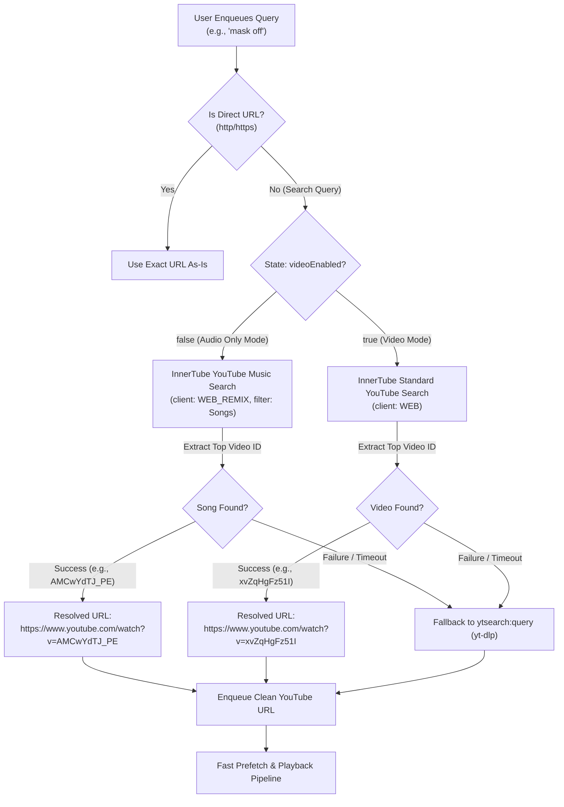

# Implementation Plan: Fast InnerTube Search & Audio-Preferred Playback

This plan outlines how to optimize search resolution in the Sharkord Music Bot by replacing slow `yt-dlp` process-based searches with direct, zero-API-key **InnerTube** HTTP requests (~10x faster) and intelligently routing queries based on the `videoEnabled` toggle so audio-only mode prioritizes clean studio audio versions (YouTube Music Topic tracks) instead of music videos.

---

## 1. High-Level Architecture & Workflow

Currently, non-URL search queries are formatted as `ytsearch:<query>` and handed to `yt-dlp`. `yt-dlp` spawns a Python child process, loads 1,700+ extractors, downloads the YouTube search webpage, and scrapes video IDs. This process takes **4 to 5.5 seconds** and, on regular YouTube, almost always returns official music videos (which often include spoken dialogue, skits, and sound effects).

By calling YouTube's public internal **InnerTube** API via native Bun `fetch`:
1. Search latency drops from **~5,000ms to ~250–500ms**.
2. No API key or Google Cloud project is needed.
3. We can query **YouTube Music** (`WEB_REMIX`) with a strict `Songs` filter when video is disabled, giving users the clean album track (e.g., `AMCwYdTJ_PE`).
4. When video is enabled, we query **Standard YouTube** (`WEB`), delivering the official music video (e.g., `xvZqHgFz51I`).



---

## 2. API Specifications (InnerTube Endpoints)

Both endpoints accept `POST` requests, require no authentication headers, and operate over standard JSON.

### A. YouTube Music (`WEB_REMIX`) — Audio Mode
- **URL:** `https://music.youtube.com/youtubei/v1/search`
- **Headers:** `{ "Content-Type": "application/json" }`
- **Payload:**
  ```json
  {
    "context": {
      "client": {
        "clientName": "WEB_REMIX",
        "clientVersion": "1.20240101.01.00",
        "hl": "en",
        "gl": "US"
      }
    },
    "query": "<user search query>",
    "params": "EgWKAQIIAWoQEAUQAxAEEAkQChAKEAkQCQ=="
  }
  ```
  *(Note: `params` is YouTube Music's protobuf filter specifically for **Songs**, excluding artists, playlists, and video clips).*
- **Extraction Path:**
  `data.contents.tabbedSearchResultsRenderer.tabs[0].tabRenderer.content.sectionListRenderer.contents[0].musicShelfRenderer.contents[0].musicResponsiveListItemRenderer.playlistItemData.videoId`

### B. Standard YouTube (`WEB`) — Video Mode
- **URL:** `https://www.youtube.com/youtubei/v1/search`
- **Headers:** `{ "Content-Type": "application/json" }`
- **Payload:**
  ```json
  {
    "context": {
      "client": {
        "clientName": "WEB",
        "clientVersion": "2.20240101.01.00",
        "hl": "en",
        "gl": "US"
      }
    },
    "query": "<user search query>"
  }
  ```
- **Extraction Path:**
  Find the first item with `videoRenderer` inside:
  `data.contents.twoColumnSearchResultsRenderer.primaryContents.sectionListRenderer.contents` -> `itemSectionRenderer.contents` -> `item.videoRenderer.videoId`.

---

## 3. Detailed Implementation Steps

### Phase 1: Dedicated Search Module (`src/server/search.ts`)

Create a clean, isolated search resolver module handling both targets:

1. **`searchYouTubeMusicSong(query: string, options?: { proxy?: string }): Promise<string | null>`**
   - Dispatches the `WEB_REMIX` search with the Songs protobuf filter.
   - Returns the top 11-character `videoId` or `null`.
   - Uses `AbortSignal.timeout(4000)` to ensure searches never hang.
   - Passes `{ proxy: options?.proxy }` to Bun's native `fetch` if a proxy is configured.

2. **`searchYouTubeWebVideo(query: string, options?: { proxy?: string }): Promise<string | null>`**
   - Dispatches the `WEB` search for general YouTube.
   - Returns the top 11-character `videoId` or `null`.
   - Applies the same timeout and proxy support.

3. **`resolveSearchQuery(query: string, videoEnabled: boolean, options?: { proxy?: string; log?: (msg: string) => void }): Promise<string>`**
   - If `query` already starts with `http://` or `https://`, returns it immediately.
   - If `videoEnabled === false`, attempts `searchYouTubeMusicSong`.
   - If `videoEnabled === true`, attempts `searchYouTubeWebVideo`.
   - If InnerTube returns a valid `videoId`, returns `https://www.youtube.com/watch?v=${videoId}`.
   - **Fallback:** If InnerTube fails, times out, or returns no items, safely returns `ytsearch:${trimmedQuery}` so `yt-dlp` handles it as before.

---

### Phase 2: Server Action & Queue Integration (`src/server/index.ts`)

Update the `play` action handler in `src/server/index.ts`:

1. **Replace Synchronous `normalizePlayableSource` on Play:**
   - In the `play` action handler (around line 781):
     ```ts
     // Resolve query asynchronously before enqueuing
     const sourceUrl = await resolveSearchQuery(
       payload.query,
       getState(channelId).videoEnabled,
       {
         proxy: getPlaybackSettings(channelId).proxy,
         log: (msg) => ctx.log(msg),
       }
     );
     ```
2. **Immediate URL Display in UI Queue:**
   - Instead of storing `ytsearch:mask off` in the queue, the queue now immediately holds `https://www.youtube.com/watch?v=AMCwYdTJ_PE`.
   - Prefetching and metadata resolution (`resolveYouTubeTrack`) receive a direct video URL right away, shaving off several seconds of prefetch/start time.

---

### Phase 3: Proxy & Network Hardening

1. **Proxy Propagation:**
   - Bun's native `fetch` supports `proxy: string` directly in `RequestInit`.
   - Ensure the server's configured `Proxy URL` setting (`getPlaybackSettings(channelId).proxy`) is passed into the search functions.

2. **Defensive Parsing:**
   - YouTube occasionally returns different layout variations or experiments. Use defensive optional chaining (`?.`) when navigating response objects.
   - Any unparseable layout immediately falls back to `ytsearch:` without throwing errors to the end user.

---

## 4. Verification & Testing Checklist

- [ ] **Test 1: Audio-Only Mode (`videoEnabled = false`)**
  - Search `"mask off"`: Verifies that the resolved track is `AMCwYdTJ_PE` (official studio audio).
  - Search `"michael jackson thriller"`: Verifies that it returns the clean album track (`Z85lxckrtzg`) rather than the 14-minute movie music video.
- [ ] **Test 2: Video Mode (`videoEnabled = true`)**
  - Search `"mask off"`: Verifies that the resolved track is `xvZqHgFz51I` (official music video).
- [ ] **Test 3: Direct URLs**
  - Paste `https://www.youtube.com/watch?v=xvZqHgFz51I`: Verifies that explicit URLs are preserved and not overwritten.
- [ ] **Test 4: Fallback Safety Net**
  - Simulate an offline/blocked InnerTube endpoint: Verifies that the bot falls back to `ytsearch:<query>` and continues playing.
- [ ] **Test 5: Proxy Support**
  - If a proxy is set in plugin settings, verify the `fetch` options forward traffic through the proxy.
- [ ] **Test 6: Latency Benchmarking**
  - Compare queue addition time before (< 500ms) vs. after (> 4000ms).
