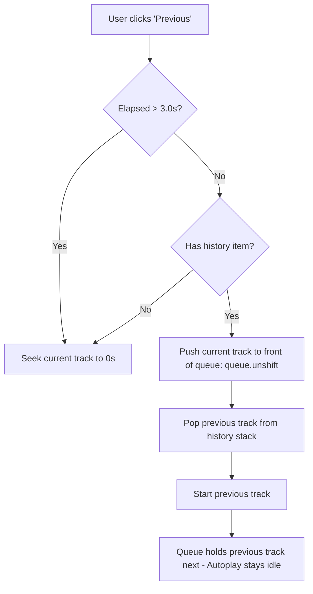

# Implementation Plan: Previous Track Navigation, Pause/Resume & Transport Controls

This document details the architecture, state lifecycle, and step-by-step implementation plan for adding:
1. A **Previous Track** button with standard music player behavior (restarts the current track if playing for more than 3 seconds; jumps to the previous track in history on subsequent/early presses).
2. A **Pause / Resume** button replacing the center button with a dynamic Play/Pause toggle.
3. A relocated **Stop** button situated to the left of the transport controls, yielding the standard media player layout:  
   `[Stop] [Previous] [Play/Pause (Hero)] [Next]`.
4. Full **Playlist & Autoplay Preservation**: Navigating to a previous song keeps the upcoming track list intact by pushing the current track back to the front of the queue, ensuring autoplay will not search for new tracks until all remaining songs finish.

---

## 1. Current State Analysis (v0.0.29)

### Controls Layout
Currently, the transport controls (`.mb-transport` in `src/client/player.tsx`) consist of only two buttons:
- Main hero button (`.mb-ctrl-main`): **Stop** (square icon while playing).
- Secondary button (`.mb-ctrl`): **Next** (skip-forward icon).

### Playback & State Architecture
- **Active State (`player-state.ts`)**: Tracks `currentSong`, `currentSourceUrl`, `currentTrackInfo`, `currentInvokerUserId`, `currentThumbnailUrl`, `playbackStartedAtEpochMs`, and `currentTrackDurationSeconds`.
- **Queue (`queue`)**: An array of `TQueueItem` waiting to be played.
- **Autoplay Deduplication (`recentVideoIds`)**: A rolling string array of recently played YouTube video IDs to prevent autoplay from repeating tracks. However, this only stores video ID strings, not the full playable track objects or invoker metadata needed to replay historical songs.
- **Elapsed Time Tracking**: The client computes elapsed seconds dynamically from `playbackStartedAtEpochMs`:
  $$\text{elapsed} = \max(0, \lfloor (\text{Date.now()} - \text{playbackStartedAtEpochMs}) / 1000 \rfloor)$$
  Because elapsed time is continuously derived from the clock, there is currently no concept of a "frozen" or "paused" time position.
- **WebRTC Transport Lifecycle (v0.0.29)**: Seeking cleanly recreates the `PlainTransport`, `Producer`, and external stream (`ctx.voice.createStream`), ensuring mediasoup's `comedia: true` UDP port latching and Sharkord's stream presence operate reliably without dropping listeners.

---

## 2. Feature Specifications & Behavioral Rules

### A. Previous Button Behavior
Standard media players (Spotify, Apple Music, VLC, Winamp) follow these exact rules:

1. **Threshold Check ($\text{Elapsed} > 3\text{s}$)**:
   - If the current track has been playing for **more than 3.0 seconds**, pressing **Previous** restarts the current song from the beginning ($0\text{s}$) via seeking.
   - The song history remains unchanged.
2. **Jump to Previous Song ($\text{Elapsed} \le 3\text{s}$ or repeated presses)**:
   - If the current track is within its first 3 seconds, or if the user presses Previous again immediately after restarting, the player navigates to the previous track in history.
   - If no historical tracks exist, it restarts the current track at $0\text{s}$.
3. **Queue Preservation (Crucial for Playlist & Autoplay Integrity)**:
   - When jumping back from **Song B** to **Song A**:
     - The current track (**Song B**) is placed at the **front of the queue** (`queue.unshift(currentSongItem)`).
     - **Song A** is popped from the history stack and starts playback immediately.
     - As a result, the queue becomes `[Song B, ...upcomingQueue]`.
     - When **Song A** finishes playing, playback naturally moves forward to **Song B**, preserving the user's upcoming playlist.
     - Because the queue is not empty, **Autoplay is suppressed** until **Song B** (and any other queued tracks) finish completely.



---

### B. Pause / Resume Behavior

1. **Pause Action (`pauseMusic`)**:
   - Computes and records `state.pausedPositionSeconds = currentElapsedSeconds`.
   - Sets `state.isPaused = true`.
   - Terminates the active FFmpeg process so it stops consuming network bandwidth, CPU, and chunk-proxy resources.
   - Keeps the Sharkord voice stream handle and mediasoup producers intact, or holds state so the voice tile remains cleanly registered in the channel.
   - Broadcasts the updated player state with `isPaused: true` and `pausedPositionSeconds`.
2. **Client Timeline During Pause**:
   - The scrubber and elapsed timer stop advancing, remaining locked at `pausedPositionSeconds`.
   - The center hero button displays the **Play** icon instead of the Pause icon.
3. **Resume Action (`resumeMusic`)**:
   - Sets `state.isPaused = false`.
   - Resumes playback from `state.pausedPositionSeconds` using the proven v0.0.29 stream recreation pipeline (`-ss <pausedPositionSeconds>`), ensuring Mediasoup accepts RTP packets from the newly spawned FFmpeg process.
   - Updates `state.playbackStartedAtEpochMs = Date.now() - (pausedPositionSeconds * 1000)`.
   - Clears `state.pausedPositionSeconds = null`.
   - Broadcasts the updated player state.

---

### C. Updated Transport Controls Layout

The new control bar replaces the 2-button layout with a 4-button media cluster:

```
+----------------------------------------------------------------------------------+
|  [Autoplay]       [Stop]   [Previous]   [Play / Pause]   [Next]     (v) [====|==]  |
|  [Video   ]       (ctrl)     (ctrl)      (ctrl-main)     (ctrl)                    |
+----------------------------------------------------------------------------------+
```

1. **Stop (`.mb-ctrl`)**:
   - Secondary button with `StopIcon` (square).
   - Completely terminates playback, clears the queue and channel state, and removes the stream tile.
2. **Previous (`.mb-ctrl`)**:
   - Secondary button with `PreviousIcon` (skip-back).
   - Disabled when nothing is playing and history is empty.
3. **Play / Pause (`.mb-ctrl-main`)**:
   - Primary hero button (large white circle, 48px).
   - Displays `PauseIcon` when playing.
   - Displays `PlayIcon` when paused.
   - When idle/stopped, disabled or triggers playback if items exist in the queue.
4. **Next (`.mb-ctrl`)**:
   - Secondary button with `SkipIcon` (skip-forward).
   - Skips to the next queued item, or triggers autoplay recommendation if queue is empty.

---

## 3. Architecture & Data Structures

### A. Contract Updates (`src/contract.ts`)

```ts
type PlayerStateSnapshot = {
  // Existing fields
  currentSong: string | null;
  currentInvokerUserId: number | null;
  currentThumbnailUrl: string | null;
  videoLabel: string | null;
  streamActive: boolean;
  streamStarting: boolean;
  playbackStartedAtEpochMs: number | null;
  currentTrackDurationSeconds: number | null;
  volume: number;
  queue: PlayerQueueEntry[];
  autoplay: boolean;
  videoEnabled: boolean;

  // New fields
  isPaused: boolean;
  pausedPositionSeconds: number | null;
  hasPrevious: boolean;
};

type TSharkord = {
  actions: {
    // ... existing actions (playMusic, seekMusic, stopMusic, etc.) ...
    pauseMusic: {
      payload: void;
      response: PlayerActionResponse;
    };
    resumeMusic: {
      payload: void;
      response: PlayerActionResponse;
    };
    previousMusic: {
      payload: void;
      response: PlayerActionResponse;
    };
  };
};
```

---

### B. State Management (`src/server/player-state.ts`)

1. **Track History Item Type**:
   ```ts
   type THistoryItem = {
     sourceUrl: string;
     invokerUserId: number;
     title: string;
     thumbnailUrl?: string | null;
     resolvedTrack?: TYtDlpTrackInfo | null;
   };
   ```

2. **Channel State Extensions**:
   ```ts
   type ChannelStreamState = {
     // ... existing fields ...
     isPaused: boolean;
     pausedPositionSeconds: number | null;
     history: THistoryItem[];
   };
   ```

3. **History Helpers**:
   - `pushToHistory(channelId: number, item: THistoryItem)`: Prepends or appends to history (capped at e.g. 50 tracks to prevent unbounded memory growth).
   - `popFromHistory(channelId: number)`: Retrieves and removes the most recently played track.
   - `peekHistory(channelId: number)`: Checks if a previous track is available without popping.
   - `unshiftToQueue(channelId: number, item: TQueueItem)`: Inserts an item at index 0 of `state.queue`.

---

### C. Server Playback & Lifecycle Integration (`src/server/index.ts`)

#### 1. Tracking Track Completion into History
When a track transitions (either naturally via `onEnd` or when skipped via `nextMusic`):
```ts
if (state.currentSourceUrl && state.currentSong) {
  pushToHistory(channelId, {
    sourceUrl: state.currentSourceUrl,
    invokerUserId: state.currentInvokerUserId ?? 0,
    title: state.currentSong,
    thumbnailUrl: state.currentThumbnailUrl,
    resolvedTrack: state.currentTrackInfo,
  });
}
```

#### 2. Previous Action Implementation (`previousMusic`)
```ts
const handlePreviousMusic = async (ctx: TMusicContext, channelId: number, options: PlaybackSettings) => {
  const state = getState(channelId);
  if (!state.streamActive) throw new Error("Nothing is currently playing.");

  const elapsedSeconds = state.isPaused
    ? (state.pausedPositionSeconds ?? 0)
    : Math.max(0, (Date.now() - (state.playbackStartedAtEpochMs ?? Date.now())) / 1000);

  // Rule 1: If elapsed > 3.0s, restart the current track
  if (elapsedSeconds > 3.0) {
    ctx.logger.log(`Previous action: restarting current track from 0s (elapsed was ${elapsedSeconds.toFixed(1)}s)`);
    await seekCurrentStream(ctx, channelId, 0, options);
    return;
  }

  // Rule 2: If elapsed <= 3.0s, check if we have history
  const previousItem = popFromHistory(channelId);
  if (!previousItem) {
    // No history available, restart current track from 0s
    ctx.logger.log("Previous action: no track in history, restarting from 0s");
    await seekCurrentStream(ctx, channelId, 0, options);
    return;
  }

  // Preserve upcoming playlist: push the current song back to the start of the queue
  if (state.currentSourceUrl) {
    unshiftToQueue(channelId, {
      sourceUrl: state.currentSourceUrl,
      invokerUserId: state.currentInvokerUserId ?? 0,
      resolvedTrack: state.currentTrackInfo,
    });
  }

  // Play the historical track
  state.endAction = "none";
  cleanupChannel(ctx, channelId);

  await startMusicStream(
    ctx,
    channelId,
    previousItem.sourceUrl,
    options,
    previousItem.invokerUserId,
    previousItem.resolvedTrack ?? undefined,
  );
};
```

#### 3. Pause & Resume Implementation
- **Pause**:
  ```ts
  const pauseCurrentStream = async (ctx: TMusicContext, channelId: number) => {
    const state = getState(channelId);
    if (!state.streamActive || state.isPaused) return;

    const elapsed = Math.max(0, (Date.now() - (state.playbackStartedAtEpochMs ?? Date.now())) / 1000);
    state.isPaused = true;
    state.pausedPositionSeconds = elapsed;

    if (state.ffmpegProcess) {
      const proc = state.ffmpegProcess;
      state.ffmpegProcess = null;
      await killMusicStream(proc);
    }

    publishPlayerState(ctx, channelId);
  };
  ```

- **Resume**:
  ```ts
  const resumeCurrentStream = async (ctx: TMusicContext, channelId: number, options: PlaybackSettings) => {
    const state = getState(channelId);
    if (!state.streamActive || !state.isPaused) return;

    const resumeSeconds = state.pausedPositionSeconds ?? 0;
    state.isPaused = false;
    state.pausedPositionSeconds = null;

    // Use our proven seek stream pipeline to cleanly restart FFmpeg and Mediasoup transports
    await seekCurrentStream(ctx, channelId, resumeSeconds, options);
  };
  ```

---

### D. Client Implementation

#### 1. Icons (`src/client/icons.tsx`)
Add standard Lucide-compatible SVG icons:
- `PauseIcon`: Two vertical rounded bars (`M6 4h4v16H6z`, `M14 4h4v16h-4z`).
- `PreviousIcon`: Skip-back shape (`M3 19V5`, right triangle pointing left).

#### 2. Hook Updates (`src/client/use-player.ts`)
- Add actions: `pause()`, `resume()`, `previous()`.
- Update `elapsedSeconds` calculation:
  ```ts
  const elapsedSeconds = player.isPaused && player.pausedPositionSeconds !== null
    ? Math.floor(player.pausedPositionSeconds)
    : calculateLiveElapsed(player.playbackStartedAtEpochMs);
  ```
- Expose permission and availability flags:
  ```ts
  canPrevious: player.streamActive && (elapsedSeconds > 3 || player.hasPrevious),
  canPause: player.streamActive && !player.isPaused,
  canResume: player.streamActive && player.isPaused,
  ```

#### 3. UI Component (`src/client/player.tsx`)
In `.mb-transport`:
```tsx
<div className="mb-transport">
  {/* 1. Stop button */}
  <button
    type="button"
    className="mb-ctrl"
    title="Stop playback"
    aria-label="Stop playback"
    disabled={isBusy || !isPlaying || !can.stop}
    onClick={stop}
  >
    <StopIcon size={18} />
  </button>

  {/* 2. Previous button */}
  <button
    type="button"
    className="mb-ctrl"
    title={elapsedSeconds > 3 ? "Restart track" : "Previous track"}
    aria-label={elapsedSeconds > 3 ? "Restart track" : "Previous track"}
    disabled={isBusy || !isPlaying || !can.previous}
    onClick={previous}
  >
    <PreviousIcon size={20} />
  </button>

  {/* 3. Hero Play / Pause button */}
  <button
    type="button"
    className="mb-ctrl mb-ctrl-main"
    title={player.isPaused ? "Resume playback" : "Pause playback"}
    aria-label={player.isPaused ? "Resume playback" : "Pause playback"}
    disabled={isBusy || !isPlaying || (!can.pause && !can.resume)}
    onClick={player.isPaused ? resume : pause}
  >
    {player.isPaused ? <PlayIcon size={22} /> : <PauseIcon size={20} />}
  </button>

  {/* 4. Next button */}
  <button
    type="button"
    className="mb-ctrl"
    title="Skip to the next track"
    aria-label="Skip to the next track"
    disabled={isBusy || !can.skip || (!isPlaying && player.queue.length === 0)}
    onClick={skip}
  >
    <SkipIcon size={20} />
  </button>
</div>
```

#### 4. Styling Adjustments (`src/client/styles.ts`)
Adjust `.mb-transport` gap to cleanly accommodate four buttons:
```css
.mb-transport {
  grid-column: 2;
  display: flex;
  align-items: center;
  gap: 14px; /* Reduced from 24px so 4 controls fit proportionally */
}
```

---

## 4. Edge Cases & Safeguards

| Scenario | Risk | Mitigation |
| :--- | :--- | :--- |
| **Rapid Double-Clicking Previous** | Race condition spawning multiple FFmpeg instances | Guarded by `streamGeneration` counter and `isBusy` action mutex. |
| **Paused for an Extended Period** | Google Video stream URL or chunk proxy token expires | The chunk proxy (`chunk-proxy.ts`) already has automatic `refreshUrl` and Range reconnection logic; `seekCurrentStream` initiates a fresh connection on resume. |
| **User Seeks While Paused** | Timeline and audio become desynchronized | Seeking while paused updates `pausedPositionSeconds` to the seek target without immediately resuming playback (or immediately resumes at that position). |
| **Queue Has Tracks When Previous Pressed** | Queue order or upcoming tracks are lost | Current track is placed at index 0 of `queue` (`unshift`); existing queue items remain at indices 1, 2, ... $N$. |
| **Autoplay Interaction** | Autoplay triggers unexpectedly when navigating back | Because the unshifted track is in the queue, `queue.length > 0`; autoplay is strictly suppressed until the queue reaches 0. |

---

## 5. Execution Steps for Implementation

1. **Step 1: Contract (`src/contract.ts`)**
   - Add `isPaused`, `pausedPositionSeconds`, and `hasPrevious` to `PlayerStateSnapshot`.
   - Register actions `pauseMusic`, `resumeMusic`, and `previousMusic`.
2. **Step 2: Server State (`src/server/player-state.ts`)**
   - Add `history: THistoryItem[]`, `isPaused: boolean`, `pausedPositionSeconds: number | null` to `ChannelStreamState`.
   - Implement `pushToHistory`, `popFromHistory`, and `unshiftToQueue`.
   - Include new fields in `getPlayerStateSnapshot()`.
3. **Step 3: Server Handlers (`src/server/index.ts`)**
   - Push completed/skipped tracks to history in `startMusicStream` and `playNextInQueue`.
   - Implement `previousMusic` with the $>3\text{s}$ restart rule and queue preservation.
   - Implement `pauseMusic` and `resumeMusic` leveraging `seekCurrentStream`.
   - Register the 3 actions in `onLoad`.
4. **Step 4: Client Icons & Styles (`src/client/icons.tsx`, `src/client/styles.ts`)**
   - Add `PauseIcon` and `PreviousIcon`.
   - Tune `.mb-transport` gap to 14px.
5. **Step 5: Client Hook & UI (`src/client/use-player.ts`, `src/client/player.tsx`)**
   - Wire actions to `usePlayer`.
   - Render the `[Stop] [Previous] [Play/Pause] [Next]` button row.
6. **Step 6: Build & Verification**
   - `bun x tsc --noEmit` and `bun run build`.
   - Bump version to `0.0.30`.
