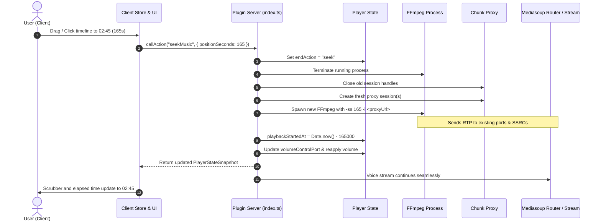

# Implementation Plan: Timeline Seeking & Interactive Scrubber

This document outlines the architecture, pipeline changes, and step-by-step implementation plan for adding timeline seeking (scrubbing) to the Sharkord Music Bot. This allows users to jump to any point in the video or audio (start, middle, end) directly from the client interface while keeping the WebRTC stream uninterrupted.

---

## 1. Current State & Architecture Analysis (v0.0.21)

Recent updates introduced fast InnerTube searching, dedicated YouTube Music audio vs. YouTube Video routing, persistent chunk proxying, and live volume adjustments via FFmpeg's `azmq` filter.

The playback stack currently operates as follows:

1. **WebRTC Media Delivery:**
   - The bot creates a `PlainTransport` on the voice channel's mediasoup router with listening RTP ports (`audioRtpPort` and optional `videoRtpPort`).
   - Mediasoup producers (`audioProducer` and `videoProducer`) are created once when playback starts and attached to `ctx.voice.createStream`.
   - Viewers connect to this voice stream in Sharkord.

2. **FFmpeg & Chunk Proxy Pipeline:**
   - Audio and video URLs are proxied through local loopback sessions (`chunk-proxy.ts`) that handle HTTP `Range: bytes=X-Y` requests to googlevideo.
   - FFmpeg (`ffmpeg.ts`) reads these paced inputs (`-re -i <url>`), applies the volume filter and `azmq` socket (`volume-control.ts`), and streams RTP packets to the mediasoup ports.
   - When the track ends naturally, FFmpeg exits, triggering `onEnd` in `startMusicStream`, which runs `cleanupChannel` and triggers `playNextInQueue` or autoplay.

3. **Current Client Progress Tracking:**
   - The server publishes `playbackStartedAtEpochMs` and `currentTrackDurationSeconds`.
   - In `use-player.ts`, `useElapsedSeconds` calculates:
     $$\text{elapsed} = \max(0, \lfloor (\text{Date.now()} - \text{playbackStartedAtEpochMs}) / 1000 \rfloor)$$
   - In `player.tsx`, the timeline (`mb-bar`) is a static, non-interactive `<div>` showing `progressPercent`.

---

## 2. Core Mechanism: How Seeking Works

### Why Viewers Won't Disconnect
In WebRTC, as long as the mediasoup `Producer` and `PlainTransport` remain open, connected clients never lose the stream. FFmpeg is simply the RTP UDP source pushing packets into that transport.

When seeking to `targetSeconds`:
1. **Preserve Mediasoup Transports & Producers:** Do **not** destroy `streamHandle`, `audioProducer`, `videoProducer`, or transports.
2. **Graceful FFmpeg Restart with `-ss`:**
   - Set an internal flag `state.endAction = "seek"` to ensure the old FFmpeg process exit does not trigger channel cleanup or advance the queue.
   - Terminate the active FFmpeg process and close its chunk proxy sessions.
   - Spawn a new FFmpeg process targeting the **exact same** RTP ports, SSRCs, and payloads, with `-ss <targetSeconds>` placed before each input (`-i`).
   - Because `-ss` is placed before `-i`, FFmpeg performs a **demuxer seek** via HTTP Range requests. The chunk proxy (`chunk-proxy.ts`) already supports Range requests and will fetch from the new byte offset instantly.
3. **Keyframe Alignment:**
   - For H.264 video, FFmpeg transcode starts immediately with an IDR keyframe at `targetSeconds`.
   - For VP9 video (`-c:v copy`), FFmpeg seeks to the nearest keyframe preceding `targetSeconds`.
4. **State & Live Control Resynchronization:**
   - Update `state.playbackStartedAtEpochMs = Date.now() - (targetSeconds * 1000)`.
   - Update `state.volumeControlPort` with the new process's `azmq` port and re-apply `state.volume`.
   - Broadcast the updated `playerState` to all users in the channel.



---

## 3. Detailed Implementation Steps

### Phase 1: Contract & Types (`src/contract.ts`)

Add the `seekMusic` action to the plugin contract:

```ts
// src/contract.ts
type TSharkord = {
  actions: {
    // ... existing actions ...
    seekMusic: {
      payload: { positionSeconds: number };
      response: PlayerActionResponse;
    };
  };
  // ...
};
```

---

### Phase 2: State Tracking (`src/server/player-state.ts`)

To restart FFmpeg at a new offset without re-fetching from `yt-dlp`, `ChannelStreamState` needs to retain the current track's metadata and resolved streams:

1. **Extend `ChannelStreamState`:**
   ```ts
   type ChannelStreamState = {
     // ... existing fields ...
     currentSourceUrl: string | null;
     currentTrackInfo: TYtDlpTrackInfo | null;
     isSeeking: boolean;
   };
   ```

2. **Initialize & Clean:**
   - Set `currentSourceUrl: null`, `currentTrackInfo: null`, and `isSeeking: false` in `createInitialState()`.
   - Reset these fields in `cleanupChannel()`.

---

### Phase 3: FFmpeg Pipeline Seeking (`src/server/ffmpeg.ts`)

1. **Add `seekSeconds` to `TMusicOptions`:**
   ```ts
   type TMusicOptions = {
     // ... existing fields ...
     seekSeconds?: number;
   };
   ```

2. **Inject `-ss` into Paced Input Arguments:**
   In `spawnMusicStream`, update `pacedInput` so that if `seekSeconds` is provided and `> 0`, `-ss` is placed **before** the `-i` parameter:

   ```ts
   const pacedInput = (url: string): string[] => {
     const args = [...reconnectArgs(inputUserAgent, isLocalUrl(url))];
     if (options.seekSeconds && options.seekSeconds > 0) {
       args.push("-ss", options.seekSeconds.toFixed(3));
     }
     args.push(
       "-re",
       "-readrate_initial_burst",
       String(INPUT_INITIAL_BURST_SECONDS),
       "-i",
       url,
     );
     return args;
   };
   ```

   Apply this to both:
   - Video & audio multi-input (`videoInputs.video`, `videoInputs.audio`).
   - Single audio input (`inputSource`).

---

### Phase 4: Server Seek Handler (`src/server/index.ts`)

1. **Implement `seekCurrentStream`:**
   Create a dedicated function that restarts FFmpeg on the active transports:
   ```ts
   const seekCurrentStream = async (
     ctx: TMusicContext,
     channelId: number,
     targetSeconds: number,
     options: PlaybackSettings,
   ): Promise<void> => {
     const state = getState(channelId);
     if (!state.streamActive || !state.audioTransport || !state.currentTrackInfo) {
       throw new Error("No active stream to seek.");
     }

     const duration = state.currentTrackDurationSeconds ?? 0;
     const clampedSeconds = Math.max(0, Math.min(targetSeconds, Math.max(0, duration - 1)));

     state.isSeeking = true;
     state.endAction = "none";

     // 1. Terminate old FFmpeg without closing producers or transports
     if (state.ffmpegProcess) {
       killMusicStream(state.ffmpegProcess);
       state.ffmpegProcess = null;
     }

     const { ip } = ctx.voice.getListenInfo();
     const trackInfo = state.currentTrackInfo;
     const sourceUrl = state.currentSourceUrl ?? trackInfo.webpageUrl ?? "";

     // 2. Spawn new FFmpeg with seekSeconds
     const result = await spawnMusicStream({
       sourceUrl,
       audioPayloadType: 111,
       audioSsrc: state.audioProducer ? getProducerSsrc(state.audioProducer) : audioSsrc,
       rtpHost: ip,
       audioRtpPort: state.audioTransport.tuple.localPort,
       ...(state.videoTransport && state.activeVideoCodec && state.videoProducer
         ? {
             videoPayloadType: getVideoPayloadType(state.activeVideoCodec),
             videoSsrc: getProducerSsrc(state.videoProducer),
             videoRtpPort: state.videoTransport.tuple.localPort,
           }
         : {}),
       volume: state.volume,
       bitrate: options.bitrate,
       proxy: options.proxy,
       limitFps: options.limitFps,
       videoMaxHeight: trackInfo.resolvedMaxHeight,
       preResolvedTrack: trackInfo,
       seekSeconds: clampedSeconds,
       log: ctx.logger.log,
       error: ctx.logger.error,
       debug: ctx.logger.debug,
       onEnd: () => handleStreamEnd(ctx, channelId, options),
     });

     state.ffmpegProcess = result.process;
     state.volumeControlPort = result.controlPort ?? null;
     state.playbackStartedAtEpochMs = Date.now() - Math.round(clampedSeconds * 1000);
     state.isSeeking = false;

     publishPlayerState(ctx, channelId);
   };
   ```

2. **Register the `seekMusic` Action:**
   ```ts
   ctx.actions.register({
     name: "seekMusic",
     description: "Seeks to a specific position in the current track",
     requires: Permission.JOIN_VOICE_CHANNELS,
     executes: async (invoker, payload) => {
       const channelId = requireVoiceChannelId(
         invoker.currentVoiceChannelId,
         "You must be in a voice channel to seek.",
       );
       const state = getState(channelId);
       if (!state.streamActive) {
         throw new Error("Nothing is currently playing.");
       }
       if (state.currentTrackDurationSeconds === null) {
         throw new Error("Cannot seek a stream with unknown duration.");
       }

       await seekCurrentStream(
         ctx,
         channelId,
         payload.positionSeconds,
         getPlaybackSettings(channelId),
       );

       return buildActionResult(
         ctx,
         `Seeked to ${formatDuration(payload.positionSeconds)}.`,
         channelId,
       );
     },
   });
   ```

3. **Guard `onEnd` Against Premature Exit:**
   In the stream exit callback, verify `!state.isSeeking`:
   ```ts
   onEnd: () => {
     if (state.isSeeking) {
       ctx.logger.debug("FFmpeg exited due to seek; ignoring onEnd cleanup");
       return;
     }
     // proceed with normal cleanup and queue progression
   }
   ```

---

### Phase 5: Client Hook & Controller (`src/client/use-player.ts`)

1. **Add `seekMusic` Permission Check & Action:**
   ```ts
   const can = {
     // ...
     seek: useCanUseAction<TSharkord>("seekMusic"),
   };
   ```

2. **Expose `seek` Function:**
   ```ts
   return {
     // ...
     seek: (positionSeconds: number) =>
       run(() => callAction("seekMusic", { positionSeconds })),
   };
   ```

---

### Phase 6: Interactive Scrubber UI (`src/client/player.tsx` & `src/client/styles.ts`)

Replace the passive progress bar with an interactive scrubber component supporting:
- **Hover expansion & thumbnail timestamp tooltip:** Displays the hovered time (e.g. `02:14`).
- **Click-to-seek:** Instantly jumps to the clicked fraction of the track.
- **Drag-to-seek:** Pointer drag tracking (`setPointerCapture`) holding a draft position locally so incoming timer ticks don't jerk the slider.
- **Debounced execution:** Seek is fired only on pointer release (`onPointerUp`), preventing intermediate process churn.
- **Keyboard navigation:** Left/Right arrow keys jump $\pm 5$ seconds when the bar is focused.

#### Component Structure:
```tsx
const ProgressBar = ({
  elapsedSeconds,
  durationSeconds,
  disabled,
  onSeek,
}: ProgressBarProps) => {
  const [isDragging, setIsDragging] = useState(false);
  const [draftPercent, setDraftPercent] = useState<number | null>(null);
  const [hoverPercent, setHoverPercent] = useState<number | null>(null);
  const barRef = useRef<HTMLDivElement>(null);

  // Computes percent from pointer position
  const getPercentFromEvent = (e: React.PointerEvent) => {
    if (!barRef.current) return 0;
    const rect = barRef.current.getBoundingClientRect();
    const x = Math.max(0, Math.min(e.clientX - rect.left, rect.width));
    return (x / rect.width) * 100;
  };

  const handlePointerDown = (e: React.PointerEvent) => {
    if (disabled || !durationSeconds) return;
    (e.target as HTMLElement).setPointerCapture(e.pointerId);
    setIsDragging(true);
    setDraftPercent(getPercentFromEvent(e));
  };

  const handlePointerMove = (e: React.PointerEvent) => {
    if (isDragging) {
      setDraftPercent(getPercentFromEvent(e));
    } else {
      setHoverPercent(getPercentFromEvent(e));
    }
  };

  const handlePointerUp = (e: React.PointerEvent) => {
    if (!isDragging) return;
    setIsDragging(false);
    const finalPercent = getPercentFromEvent(e);
    setDraftPercent(null);
    if (durationSeconds) {
      onSeek((finalPercent / 100) * durationSeconds);
    }
  };

  const currentPercent = isDragging && draftPercent !== null
    ? draftPercent
    : (elapsedSeconds && durationSeconds ? (elapsedSeconds / durationSeconds) * 100 : 0);

  return (
    <div className="mb-progress">
      <div
        ref={barRef}
        className={`mb-bar ${disabled ? "mb-bar-disabled" : "mb-bar-interactive"}`}
        onPointerDown={handlePointerDown}
        onPointerMove={handlePointerMove}
        onPointerUp={handlePointerUp}
        onPointerLeave={() => setHoverPercent(null)}
        role="slider"
        tabIndex={disabled ? -1 : 0}
        aria-valuenow={elapsedSeconds ?? 0}
        aria-valuemin={0}
        aria-valuemax={durationSeconds ?? 0}
      >
        <div className="mb-bar-fill" style={{ width: `${currentPercent}%` }}>
          <div className="mb-bar-thumb" />
        </div>
        {hoverPercent !== null && durationSeconds && (
          <div
            className="mb-bar-tooltip"
            style={{ left: `${hoverPercent}%` }}
          >
            {formatDuration((hoverPercent / 100) * durationSeconds)}
          </div>
        )}
      </div>
      <div className="mb-times">
        <span>{formatDuration(isDragging && draftPercent !== null ? (draftPercent / 100) * (durationSeconds ?? 0) : elapsedSeconds)}</span>
        <span>{formatDuration(durationSeconds)}</span>
      </div>
    </div>
  );
};
```

#### Styling Updates (`src/client/styles.ts`):
- Increase hover target area with pseudo-elements or height expansion.
- Add `.mb-bar-thumb`: A smooth circular dot that scales in on hover/drag.
- Add `.mb-bar-tooltip`: A dark floating badge displaying the hover timestamp.
- Cursor styling: `pointer` when active, `not-allowed` when disabled.

---

## 4. Edge Cases & Resilience

| Potential Issue | Impact | Mitigation Strategy |
| :--- | :--- | :--- |
| **Rapid scrub spam** | User rapidly drags or clicks across the bar, spawning multiple FFmpeg processes. | Seek fires **only on `pointerUp`**. Intermediate drags only update client draft state. |
| **Live streams** | Live streams have `durationSeconds === null`. | Disable scrubber interactions and keep progress bar in indeterminate mode. |
| **Seek to near-end** | User seeks to last second ($T > \text{duration} - 2\text{s}$). | Clamp `targetSeconds` to $\max(0, \text{duration} - 1)$ so FFmpeg doesn't exit instantly before delivering frames. |
| **Live Volume loss** | New FFmpeg process starts with default volume. | Ensure `seekCurrentStream` passes current `state.volume` into `spawnMusicStream` and binds the new `controlPort`. |
| **Old FFmpeg exit race** | Killing the old process fires its `exited` promise, potentially cleaning up the channel. | Mark `state.isSeeking = true` before killing, and check this flag in `onEnd` to bypass cleanup. |
| **Expired YouTube URLs** | If track has been playing for a long time, the video URL may have expired. | Re-use existing `refreshUrl` callback in `chunk-proxy.ts` or re-resolve if FFmpeg exits with HTTP 403. |

---

## 5. Verification Checklist

- [ ] **Audio-only Mode:** Seek forward 60 seconds on a YouTube Music song; verify audio jumps smoothly and azmq volume control remains functional.
- [ ] **Video Mode:** Seek into the middle of a 1080p video; verify video frames resume instantly with no freeze or black tile.
- [ ] **Timeline Sync:** Open the music player panel across two browser windows; verify that when Window A seeks, Window B's progress bar and timestamps snap to the new position.
- [ ] **Queue Transition:** Seek to 5 seconds before the end of a track; verify track finishes and queue advances to the next song normally.
- [ ] **Disabled States:** Verify timeline is non-interactive when nothing is playing or during stream setup.
