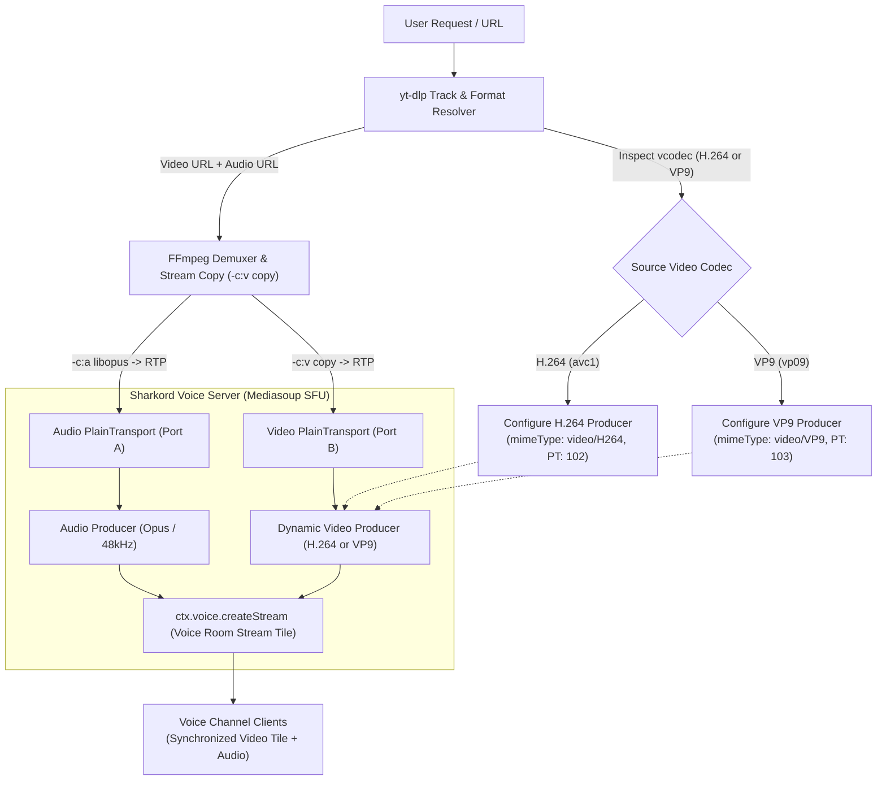

# Implementation Plan: Native WebRTC Video Streaming for Sharkord

This plan outlines how to expand the current Sharkord Music Bot plugin into a video "Watch Together" bot, streaming synchronized video and audio into Sharkord voice channels as a native stream tile with near-zero server CPU usage.

---

## 1. High-Level Architecture & Codec Insights

Sharkord's voice channels operate on **Mediasoup** (WebRTC SFU). As verified in Sharkord's screen share settings (which provides codec choices between Auto, H.264, VP8, VP9, and AV1), Sharkord's voice router natively negotiates and routes modern WebRTC video codecs.

By inspecting the source video codec from YouTube via `yt-dlp`, the bot can dynamically spawn a matching WebRTC video producer (**H.264** or **VP9**) and use FFmpeg stream copy (`-c:v copy`) to forward Google's pre-encoded video packets directly into the voice room with **near-zero CPU load**.



---

## 2. Key Components & Required Changes

### Phase 1: Dynamic Multi-Codec Resolution (`yt-dlp.ts`)

#### Goals
- Extract direct streaming URLs for both video and audio.
- Detect whether the best available video stream is **H.264 (`avc1`)** or **VP9 (`vp09`)**.
- Cover 100% of YouTube videos up to 1080p (or 1440p/4K) without forcing transcoding.

#### Implementation Details
1. **Format Selector**:
   - Update yt-dlp format selector to prioritize H.264 and VP9 (both supported by Sharkord):
     ```bash
     bestvideo[vcodec^=avc1][height<=1080]+bestaudio/bestvideo[vcodec^=vp09][height<=1080]+bestaudio/best[height<=1080]/best
     ```
2. **Metadata Object**:
   - Expand `TYtDlpTrackInfo` to store:
     ```ts
     type TVideoCodec = "h264" | "vp9" | "unsupported";

     type TYtDlpTrackInfo = {
       // ... existing fields
       videoStreamUrl?: string;
       audioStreamUrl?: string;
       videoCodec?: TVideoCodec;
       videoWidth?: number;
       videoHeight?: number;
       hasVideo: boolean;
     };
     ```
   - Detect `videoCodec` from yt-dlp's `vcodec` metadata string:
     - `vcodec.startsWith("avc1")` $\rightarrow$ `"h264"`
     - `vcodec.startsWith("vp09")` or `vcodec.startsWith("vp9")` $\rightarrow$ `"vp9"`

---

### Phase 2: Dynamic Mediasoup Video Transport & Producer (`src/server/index.ts` & `player-state.ts`)

#### Goals
- Provision a Mediasoup video `PlainTransport` alongside the existing `audioTransport`.
- Dynamically register the video producer using the codec matched in Phase 1 (**H.264** or **VP9**).

#### Implementation Details
1. **State Management (`player-state.ts`)**:
   - Add to `TChannelState`:
     ```ts
     videoTransport: PlainTransport<AppData> | null;
     videoProducer: Producer | null;
     videoProducerCloseHandler: (() => void) | null;
     activeVideoCodec: "h264" | "vp9" | null;
     ```
2. **Transport & Producer Creation (`src/server/index.ts`)**:
   - Allocate random video SSRC:
     ```ts
     const videoSsrc = Math.floor(Math.random() * 1e9);
     ```
   - Create PlainTransport:
     ```ts
     state.videoTransport = await router.createPlainTransport({
       listenIp: { ip, announcedIp: announcedAddress },
       rtcpMux: true,
       comedia: true,
       enableSrtp: false,
     });
     ```
   - Define codec parameters based on detected format:
     ```ts
     const rtpCodecs = trackInfo.videoCodec === "vp9" 
       ? [
           {
             mimeType: "video/VP9",
             payloadType: 103,
             clockRate: 90000,
             parameters: { "profile-id": 0 },
             rtcpFeedback: [
               { type: "nack" },
               { type: "nack", parameter: "pli" },
               { type: "goog-remb" },
             ],
           },
         ]
       : [
           {
             mimeType: "video/H264",
             payloadType: 102,
             clockRate: 90000,
             parameters: {
               "packetization-mode": 1,
               "profile-level-id": "42e01f",
               "level-asymmetry-allowed": 1,
             },
             rtcpFeedback: [
               { type: "nack" },
               { type: "nack", parameter: "pli" },
               { type: "goog-remb" },
             ],
           },
         ];

     state.videoProducer = await state.videoTransport.produce({
       kind: "video",
       rtpParameters: {
         codecs: rtpCodecs,
         encodings: [{ ssrc: videoSsrc }],
       },
     });
     ```
3. **Registering the Stream**:
   - Update `ctx.voice.createStream`:
     ```ts
     state.streamHandle = ctx.voice.createStream({
       key: "music",
       channelId,
       title: result.title,
       avatarUrl: "https://i.imgur.com/uVBNUK9.png",
       bannerUrl: result.thumbnailUrl,
       producers: {
         audio: state.audioProducer,
         video: state.videoProducer ?? undefined,
       },
     });
     ```

---

### Phase 3: FFmpeg Dual RTP Stream-Copy Pipeline (`src/server/ffmpeg.ts`)

#### Goals
- Demux video and audio from YouTube DASH sources.
- Stream copy video (`-c:v copy`) into RTP regardless of whether it is H.264 or VP9.
- Transcode audio into Opus RTP as done currently.

#### Implementation Details
1. **Input Mapping**:
   - YouTube DASH feeds separate audio and video URLs. FFmpeg takes both inputs:
     ```bash
     -re -reconnect 1 -reconnect_streamed 1 -reconnect_delay_max 5 -i <videoStreamUrl>
     -re -reconnect 1 -reconnect_streamed 1 -reconnect_delay_max 5 -i <audioStreamUrl>
     ```
2. **Video Payload Configuration**:
   - If H.264:
     ```bash
     -map 0:v:0
     -c:v copy
     -bsf:v h264_mp4toannexb
     -payload_type 102
     -ssrc <videoSsrc>
     -f rtp rtp://<rtpHost>:<videoRtpPort>?pkt_size=1200
     ```
   - If VP9:
     ```bash
     -map 0:v:0
     -c:v copy
     -payload_type 103
     -ssrc <videoSsrc>
     -f rtp rtp://<rtpHost>:<videoRtpPort>?pkt_size=1200
     ```
3. **Audio Stream (Unchanged)**:
   ```bash
   -map 1:a:0
   -af volume=<volumeLevel>
   -c:a libopus -ar 48000 -ac 2 -b:a <audioBitrate>
   -payload_type 111
   -ssrc <audioSsrc>
   -f rtp rtp://<rtpHost>:<audioRtpPort>?pkt_size=1200
   ```
4. **Fallback Handling**:
   - If a source has no valid video stream (e.g. audio files or SoundCloud), the pipeline automatically switches back to the existing `-vn` audio-only command.

---

### Phase 4: Lifecycle & Resource Cleanup

#### Goals
- Ensure zero dangling sockets or background processes on skips, stops, or bot disconnection.

#### Implementation Details
- In `cleanupChannel()`:
  - Close `videoProducer` and remove event listeners.
  - Close `videoTransport`.
  - Reset video state fields to `null`.

---

### Phase 5: UI & Settings Additions

1. **Plugin Settings**:
   - **Stream Video**: Global toggle (Enabled / Disabled).
   - **Max Resolution**: `720p`, `1080p`, or `1440p` (VP9 allows high-res with 0% CPU).
2. **Player UI**:
   - Small badge in player header/queue: `[1080p VP9]` or `[1080p H.264]`.

---

## 3. Codec & Resolution Compatibility Matrix

| Codec | YouTube Availability | Sharkord WebRTC Support | Server CPU Load | Notes |
| :--- | :--- | :--- | :--- | :--- |
| **H.264 (`avc1`)** | Almost all videos up to 1080p | Native (Universal) | ~1–3% (Stream Copy) | Default choice for maximum client compatibility. |
| **VP9 (`vp09`)** | 100% of all videos (including 1440p / 4K) | Native (Supported by Mediasoup / Chrome / Electron) | ~1–3% (Stream Copy) | Enables higher resolutions with zero server transcoding. |
| **AV1 (`av01`)** | Newer/popular videos | Client-dependent | ~1–3% (Stream Copy) or fallback to VP9 | Can fallback to VP9 or H.264 in yt-dlp selector. |
| **Audio-only** | SoundCloud, direct audio links | Native (Opus) | <1% | Standard audio bot mode. |

---

## 4. Verification & Testing Checklist

- [ ] Test yt-dlp resolution for an H.264 video (`avc1`) and verify stream copy works.
- [ ] Test yt-dlp resolution for a VP9 video (`vp09`) and verify stream copy works.
- [ ] Monitor CPU usage during 1080p video playback; ensure it stays under 5%.
- [ ] Confirm Sharkord renders the video stream tile in the voice channel grid with synchronized audio.
- [ ] Verify clean teardown when skipping or stopping playback.
